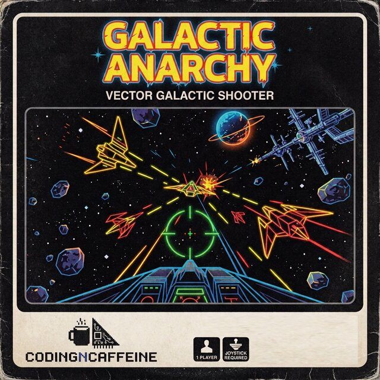
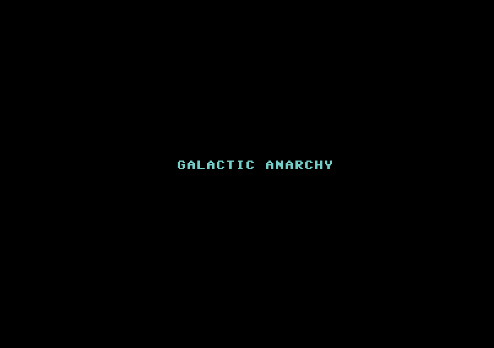

<p align="center"></p>

# Galactic Anarchy

A first-person space shooter for the Commodore 64, drawn in 3D vector graphics. It runs on
a stock PAL or NTSC machine, written in 6502 assembly.

The galaxy's government has fallen, and three factions fight over what is left: the
remains of the old navy, pirates, and the Swarm, mining machines that grew into
insect shapes and turned on everyone. You fly an interceptor across the sector map from the outer rim to the old
capital, choosing your route as you go. Sectors get harder the farther you get, and the
factions fight each other as well as you. A dogfight sector is cleared by reaching its
kill quota, and the best scores are saved to disk.

## Status

Early development, and playable. On the title screen press fire to start. Steer the
crosshair with the joystick and hold fire to shoot. Enemies come out of the distance,
first as dots and then as wireframes once they are in range of your lasers, weaving,
firing shots that home in on you, and veering away as they pass. Asteroids keep coming
straight at you and break into smaller rocks. Their yellow shots can be shot down too.
Every hit on you costs a shield block; when the shields are gone the game is over. Each
sector ends when its kill quota is reached, and the next one is faster, with more
enemies at once and more of them firing.

<p align="center"></p>

The enemies so far: the Concord Lancer and Gunship, the Corsair Raider and Mauler, the
insect machines of the Swarm (Skitter, Hornet, Moth, Mantis and their Hive), crystal
mines and asteroids. They are made in `models/`, in a plain text format.

Not done yet: the sector map, the Dreadnought and other bosses, music, saving high
scores to disk, and speed work for busier scenes. The plan is in the project's notes.

## Playing it

The game is developed and tested on [Kernal64](https://github.com/codingncaffeine/Kernal64),
a Commodore 64 core for [Emutastic](https://github.com/codingncaffeine/Emutastic-For-Linux)
and RetroArch. Open `galactic-anarchy.d64` (the disk image) in either one; the game
saves its high scores to that disk. `galactic-anarchy.prg` runs too, without saving. It should also run on other C64
emulators and on real hardware, but those are not tested yet.

Controls: a joystick in port 2. In RetroArch or Emutastic with Kernal64, the RetroPad's
d-pad steers and B is fire.

## Building

Linux, with `git`, `make` and a C compiler:

```sh
./build.sh
```

The game is written to `build/galactic-anarchy.prg` and `build/galactic-anarchy.d64`
and copied to `bin/`. If `ca65` and
`ld65` (from [cc65](https://cc65.github.io/)) are not installed, the first build fetches
cc65 V2.19 and compiles it into `.toolchain/`. On Arch Linux, `yay -S cc65` installs it.

`bin/run.sh` starts the build in RetroArch with the Kernal64 core.

The build also needs the .NET 10 SDK, which runs the project's own tool for the math
tables, the font and the models (`tools/GaTool`).

## Tests

```sh
test/run.sh
```

The tests run the game headless and silent in Kernal64's `k64run` tool, on PAL and NTSC.
`test/bench.sh` runs the benchmark scenes the same way and prints their timings.
They need a built Kernal64 in a folder next to this one (or `K64RUN` set to the path of
`k64run`) and a folder with your own C64 ROMs (`K64_ROMS`, by default
`~/.config/retroarch/system/kernal64`). The ROMs are not part of this repository.

## License

GPL-3.0-or-later. See [LICENSE](LICENSE).
